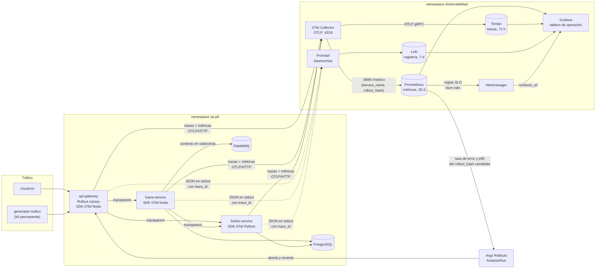

# Diagrama del flujo de telemetría

Práctica 10 · María José Tebalán Sánchez · 202100265

Recorrido de cada señal desde el servicio hasta el tablero, la alerta y la
decisión del canary. Todo lo que aparece aquí lo despliega ArgoCD desde el
repositorio GitOps; nada se instala a mano.



## Las tres señales y cómo se enlazan

| Señal | Origen | Transporte | Almacén | Enlace hacia las otras |
|---|---|---|---|---|
| Trazas | SDK OTel (spans de http, express, graphql, pg, amqplib, FastAPI, SQLAlchemy) | OTLP → Collector → Tempo | Tempo | Span → registros (Loki por `trace_id`) · Span → métricas del servicio |
| Métricas | SDK OTel: `sa_http_requests_total`, `sa_http_request_duration_seconds`, `biblioteca_*` | OTLP → Collector → `:8889` ← Prometheus | Prometheus | Panel → *Explore* en Tempo con el mismo rango de tiempo |
| Registros | `logger.js` / `observabilidad.py`: una línea JSON con `trace_id` y `span_id` | stdout → Promtail | Loki | Campo `trace_id` → traza en Tempo (*derived field*) |

## Por qué los registros no pasan por el Collector

Si el Collector falla, las trazas y las métricas dejan de llegar. Si los
registros dependieran de él, se perdería también la única señal capaz de
explicar *por qué* falló el Collector. Promtail lee el disco del nodo de forma
independiente.

## El camino de una alerta

```
sa_http_requests_total (cada 10 s desde el SDK, cada 15 s a Prometheus)
  └─ slo:sli_errores:ratio_rate5m / 1h      (regla de registro, cada 30 s)
       └─ SLODisponibilidadConsumoRapido     (ambas ventanas > 7.2 % durante 1 min)
            └─ Alertmanager: receptor "guardia" (agrupa por alertname y slo)
                 └─ anotación runbook_url → docs/runbooks/*.md
```

## El camino de la decisión del canary

```
Rollout crea el ReplicaSet candidato (hash H)
  └─ el pod recibe ROLLOUT_HASH=H (downward API de la etiqueta rollouts-pod-template-hash)
       └─ el SDK lo publica como atributo de recurso rollout.hash
            └─ el Collector lo convierte en la etiqueta rollout_hash
                 └─ AnalysisRun consulta Prometheus con rollout_hash="H"
                      └─ 2 mediciones fallidas → Rollout abortado → 100 % a la estable
```
